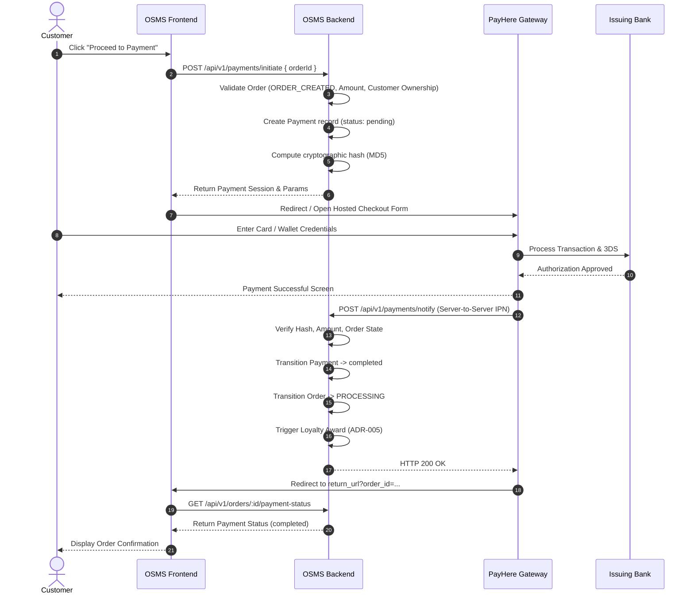
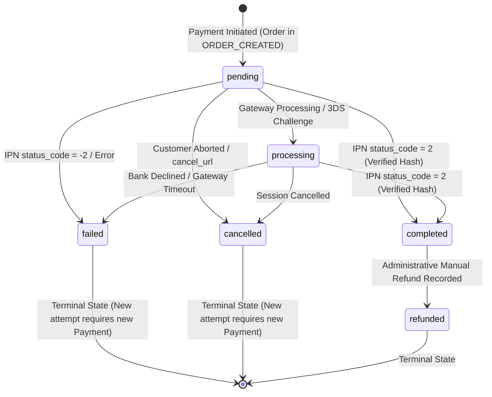
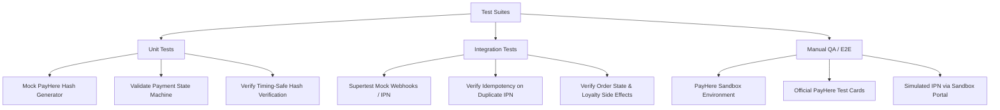

# ADR-011: Secure Payment Gateway Integration and Payment Lifecycle Architecture

## 1. Title

Secure Payment Gateway Integration, Payment Lifecycle, and Order Coordination Architecture for OSMS

## 2. Status

**Accepted** — Approved through peer review, team architectural alignment, and client stakeholder confirmation on 2026-10-14.

---

## 3. Context

The Optical Shop Management System (OSMS) requires an authoritative payment-processing architecture to support customer checkout, order fulfillment, loyalty accounting, and financial reconciliation.

The system requirements baseline includes:
- **FR-004 – Shopping Cart and Checkout**: Enabling customers to assemble products and initiate purchase checkout.
- **FR-009 – Secure Payment Gateway Processing**: Providing secure online payment processing through an external payment gateway.
- **FR-010 – Loyalty Points Calculation / Updates**: Awarding loyalty points to customers based on confirmed qualifying purchases.

Sprint 1 established foundational backend services and models:
- Initial `Order` and `OrderItem` data models.
- Initial `Payment` data model with controlled fields (`orderId`, `amount`, `status`, `method`, `providerTransactionId`).
- JWT authentication and centralized Role-Based Access Control (RBAC).
- Centralized validation and error-handling pipelines.
- Baseline backend security hardening (Helmet, rate limiting, CORS).

Sprint 2 introduces and plans:
- **DDP-036 / ADR-003**: Shopping Cart Persistence and Checkout Boundary.
- **DDP-037 / ADR-004**: Order Lifecycle and Tracking Status Model.
- **DDP-038 / ADR-005**: Loyalty Points Calculation and Persistence Model.
- **DDP-041**: Secure Checkout and Order Creation APIs.
- **DDP-042**: Frontend Checkout and Order Creation Integration.
- **DDP-055**: Secure Payment Processing Backend and Gateway Integration.

### Existing Payment Model Baseline

The current backend `Payment` model defines:
- `orderId`: Reference to the associated `Order`.
- `amount`: Transaction amount.
- `status`: Controlled enum with values: `pending`, `processing`, `completed`, `failed`, `cancelled`, `refunded`.
- `method`: Controlled enum with values: `card`, `cash`, `bank_transfer`, `online_gateway`.
- `providerTransactionId`: String identifier issued by the external payment gateway.
- Standard Mongoose timestamps (`createdAt`, `updatedAt`).

The model explicitly does **not** persist:
- Raw primary account numbers (PAN / card numbers).
- Card verification values (CVV / CVC).
- Plaintext card credentials, expiration dates, or PINs.

### Problem Statement and Existing Design Gap

Although the transactional entity exists, the approved SRS and SDS do not define:
1. The specific external payment provider/gateway selected for OSMS.
2. The environment and sandbox strategy for testing without financial transactions.
3. The integration pattern (hosted checkout vs. direct card collection vs. embedded tokenization).
4. The exact payment initiation boundary and how `Payment` records relate to `Order` records.
5. Authoritative amount and currency determination (preventing client-side price tampering).
6. Controlled online payment methods for customer checkout.
7. Legal payment state transitions and provider-verifiable success criteria.
8. Server-to-server webhook / Instant Payment Notification (IPN) verification and cryptographic signature validation.
9. Idempotency rules to prevent duplicate customer charges and duplicate callback processing.
10. System behaviour during payment failures, user cancellations, and abandoned checkout sessions.
11. Two-way coordination between the `Payment` lifecycle and the `Order` lifecycle (ADR-004).
12. Separation between checkout creation, payment completion, and final customer confirmation.
13. Payment completion boundary for triggering automatic loyalty awards (ADR-005).
14. Refund and partial-refund scope for Sprint 2.
15. Management monitoring scope vs. customer ownership and data privacy.
16. Secret management, audit logging boundaries, and safe mock testing strategies.

Without this ADR, frontend and backend developers would make divergent assumptions, resulting in security vulnerabilities, inconsistent states, duplicate charges, or out-of-scope refund implementations.

---

## 4. Relevant Requirements and Architecture References

### Software Requirements Specification (SRS)
- **FR-004**: Shopping Cart and Checkout.
- **FR-009**: Secure Payment Gateway Processing.
- **FR-010**: Loyalty Points Calculation / Updates.
- **Section 13 / 16**: Payment and Transaction Security, Data Privacy, and External Interface Requirements.

### Software Design Specification (SDS)
- **Section 4.3**: Order and Checkout Processing Flow.
- **Section 5**: Data Model — Transactional `Order` and `Payment` Entities.
- **Section 6.2**: Authorization Levels and Access Control Matrix (Management ownership of FR-009; Customer payment access).
- **Section 7**: External System Interfaces and Payment Processing.
- **Section 8**: Security Architecture, Transport Layer Security (TLS), and Secret Management.

### Architectural Decision Records (ADRs)
- **ADR-002**: Authoritative RBAC Role Model.
- **ADR-003**: Shopping Cart Persistence and Checkout Boundary.
- **ADR-004**: Order Lifecycle and Tracking Status Model.
- **ADR-005**: Loyalty Points Calculation and Persistence Model.

This ADR remains fully compatible with all accepted ADR decisions above.

---

## 5. Payment Provider Evaluation and Selection

Three primary payment gateway architectures were evaluated for OSMS (operating in Sri Lanka under Darshana Opticals (Pvt) Ltd):

### Option A — PayHere (Selected)

PayHere is Sri Lanka's leading Central Bank-approved (CBSL) payment aggregator.

#### Advantages
- **Native LKR Support**: Direct settlement and authorization in Sri Lankan Rupees (LKR) without foreign exchange conversion fees or currency mismatch risks.
- **Broad Local Instrument Coverage**: Accepts local and international Visa, Mastercard, and American Express, plus Sri Lankan mobile wallets (eZ Cash, mCash, FriMi, Genie) and local internet banking services.
- **PCI DSS Scope Elimination (SAQ A)**: Provides a provider-hosted checkout modal/redirect page. OSMS servers and browsers never collect, transmit, or store card data.
- **Robust Webhook / IPN Protocol**: Supports server-to-server Instant Payment Notifications (IPN) with MD5/HMAC cryptographic signature verification.
- **Established Sandbox**: Dedicated sandbox testing environment (`sandbox.payhere.lk`) with test credentials and simulated payment instruments.
- **Established Merchant Portal**: Management can access the PayHere Merchant Portal for manual settlement, disputed transactions, and audit verification.

#### Disadvantages
- Hosted redirect interface offers slightly less visual customization than bespoke embedded component libraries.
- Requires strict handling of IPN delivery retry quirks and server-to-server webhook acknowledgment.

### Option B — Stripe (Stripe Checkout)

Stripe is a global benchmark in developer-centric payment infrastructure.

#### Advantages
- Excellent developer tooling, comprehensive documentation, and robust client libraries.
- Rich test clock and sandbox simulation capabilities.

#### Disadvantages
- **No Native Sri Lankan Merchant Acquiring**: Stripe does not natively support direct merchant acquiring for Sri Lankan registered businesses with local LKR bank accounts without complex offshore incorporation (e.g., Stripe Atlas).
- Currency conversion from LKR incurs significant forex markups and cross-border interchange overheads for local Sri Lankan customers.
- Mobile wallet support (eZ Cash, mCash, FriMi) is unavailable.

### Option C — Direct Commercial Bank Internet Payment Gateway (MPGS / IPG)

Direct IPG integration with Sri Lankan commercial banks (e.g., Commercial Bank of Ceylon, Sampath Bank) via Mastercard Payment Gateway Services (MPGS).

#### Advantages
- Direct clearing with the merchant's corporate bank account.

#### Disadvantages
- High fixed setup costs, recurring monthly gateway fees, and stringent corporate deposit requirements disproportionate to current project stage.
- Slower onboarding, rigid legacy API contracts, and limited sandbox accessibility for automated testing.
- Excludes local mobile wallet payments.

### Decision

**PayHere (Option A) is selected** as the authoritative payment gateway provider for OSMS Sprint 2. It directly aligns with the operational, financial, and regulatory realities of Darshana Opticals in Sri Lanka.

---

## 6. Provider Environment and Sandbox Strategy

To guarantee that developers, automated CI pipelines, and QA environments never execute real financial transactions, OSMS adopts a three-tier environment configuration:

| Environment | Provider Endpoint / Gateway URL | Credentials Source | Behaviour |
|---|---|---|---|
| **Development / CI** | Mock Service / PayHere Sandbox (`https://sandbox.payhere.lk/pay/checkout`) | Local `.env` / CI Secrets (`TEST_MERCHANT_ID`, `TEST_MERCHANT_SECRET`) | Automated tests mock all gateway HTTP and IPN requests locally. Manual developer testing uses PayHere sandbox test cards. |
| **Staging / QA** | PayHere Sandbox (`https://sandbox.payhere.lk/pay/checkout`) | Staging Secret Store (`STAGING_MERCHANT_ID`, `STAGING_MERCHANT_SECRET`) | Realistic end-to-end checkout with sandbox payment instruments. Staging return and notification URLs route to staging environment domains. |
| **Production** | PayHere Live (`https://www.payhere.lk/pay/checkout`) | Production Secrets Manager (`PROD_MERCHANT_ID`, `PROD_MERCHANT_SECRET`) | Live customer transactions cleared into the merchant bank account. Strict secret rotation and monitoring. |

Automated unit and integration tests running in CI **must never connect to external provider endpoints over the live network**. All gateway interactions in automated test suites are isolated through deterministic mocks.

---

## 7. Payment Integration Pattern and Card-Data Boundary

### Hosted Redirect / Modal Pattern (Zero Card Data Exposure)

OSMS adopts the **Provider-Hosted Checkout** integration pattern:
1. The customer confirms checkout on the OSMS frontend.
2. The OSMS backend generates a signed payment payload and checkout session.
3. The customer is redirected to the secure PayHere hosted payment gateway (or loads the secure PayHere modal).
4. The customer inputs card or wallet credentials directly on the PCI DSS Level 1 certified PayHere infrastructure.
5. PayHere processes the transaction and issues a server-to-server callback (IPN) to OSMS before redirecting the customer back to OSMS return URLs.

### PCI DSS Compliance Minimization (SAQ A)

- **OSMS Client (Frontend)**: Never presents credit/debit card input fields, never intercepts card numbers, and never stores payment tokens in localStorage, sessionStorage, or Redux/React state.
- **OSMS Server (Backend)**: Never receives, logs, parses, or persists raw card numbers (PAN), expiration dates, PINs, or CVV/CVC codes.
- This architecture restricts OSMS's regulatory exposure to **PCI DSS Self-Assessment Questionnaire A (SAQ A)**, the lowest compliance burden available.



---

## 8. Payment Initiation Boundary and Order Relationship

### Initiation Boundary

A `Payment` record is created **only after** an `Order` has been successfully created and persisted in MongoDB under the `ORDER_CREATED` status (per ADR-003 and ADR-004):
1. **Cart Checkout Boundary**: The customer finalizes cart items, delivery address, and prescription links via `POST /api/v1/checkout`. The backend creates the `Order` with status `ORDER_CREATED`.
2. **Payment Boundary**: Payment initiation is explicitly triggered via `POST /api/v1/payments/initiate` passing `{ orderId }`.
3. The backend validates:
   - Order exists and belongs to the authenticated customer.
   - Order tracking status is `ORDER_CREATED`.
   - Order has not expired (within the 30-minute stock reservation window).
   - Order does not already have an existing `completed` payment.
   - No concurrent `pending` payment is in flight (or an expired pending session is cleanly superseded).
4. The backend initializes a new `Payment` record with:
   - `orderId`: Target order ID.
   - `amount`: Authoritative `Order.orderAmount`.
   - `status`: `pending`.
   - `method`: `online_gateway`.
   - `currency`: `LKR`.
5. The backend generates the PayHere payment parameters (merchant ID, order ID, formatted amount, currency, hash) and returns them to the frontend.

### Order ↔ Payment Relationship

- **1-to-1 Completed Relationship**: An `Order` can have **exactly one** `completed` `Payment` record. Once a payment completes, subsequent payment initiations for that order are strictly rejected.
- **1-to-Many Attempt Traceability**: If a customer experiences a network failure, declines a card, or cancels a payment session, that specific `Payment` record transitions to `failed` or `cancelled`. If the customer retries, the backend creates a **new distinct `Payment` attempt record** referencing the same `orderId`.
- **Traceability and Audit**: Historical failed and cancelled attempts are retained for security auditing, fraud detection, and customer support troubleshooting. They are never overwritten or deleted.
- **Single Active Session**: Only one `Payment` record for an `orderId` may be in `pending` or `processing` state at any given moment.

---

## 9. Amount, Currency, and Method Authority

### Backend-Authoritative Amount

- The monetary payable amount is **exclusively derived by the backend** from `Order.orderAmount`.
- The frontend client is **untrusted**: the frontend cannot submit, modify, or suggest the payment amount. If a client attempts to pass an `amount` parameter to `/api/v1/payments/initiate`, the backend validator strictly ignores or rejects it.
- Before constructing the gateway payload, the backend formats the amount to 2 decimal places with strict decimal rounding (e.g., `12500.00`) to prevent floating-point discrepancies.

### Currency Authority

- The official, authoritative transaction currency for OSMS is **`LKR`** (Sri Lankan Rupee).
- The currency is governed by centralized backend configuration (`PAYMENT_CURRENCY=LKR`).
- The client cannot select, alter, or negotiate the currency.

### Online Payment Method Scope

The backend `Payment` model includes controlled methods: `card`, `cash`, `bank_transfer`, `online_gateway`.

For Sprint 2 online customer checkout:
- **`online_gateway`** is the authoritative method used for all online payments processed through PayHere.
- Upon receiving the IPN callback, PayHere reports the specific payment instrument used (e.g., `VISA`, `MASTER`, `AMEX`, `EZCASH`, `GENIE`). The backend records this in the payment metadata while maintaining `method: 'online_gateway'`.
- `cash` and `bank_transfer` are explicitly **reserved for in-store physical POS or manual offline workflows**. They are not available as automated self-service checkout options in Sprint 2 online checkout.

---

## 10. Canonical Payment Lifecycle and State Transitions

### Controlled Status Values

The canonical `Payment` lifecycle uses the existing controlled statuses:
- **`pending`**: Payment session initiated on backend; customer redirected to PayHere; gateway response awaited.
- **`processing`**: PayHere acknowledges receipt of customer transaction; intermediate 3DS authorization or settlement pending.
- **`completed`**: Cryptographically verified IPN received from PayHere confirming successful funds capture (`status_code = 2`).
- **`failed`**: Gateway transaction rejected, card declined, insufficient funds, or cryptographic verification failed (`status_code = -2`).
- **`cancelled`**: Customer explicitly aborted the transaction on the hosted gateway page or returned via `cancel_url` (`status_code = -1`).
- **`refunded`**: Manual administrative status applied when an offline refund is verified and recorded by Management.

### State Transition Diagram



### Legal State Transitions Matrix

| From Status | To Status | Trigger / Condition | Side Effects |
|---|---|---|---|
| `pending` | `processing` | Customer opens gateway session / gateway notifies processing. | Audit log recorded. |
| `pending` | `completed` | Verified PayHere IPN received with `status_code = 2` and matching hash/amount. | `Order` -> `PROCESSING`; Loyalty points awarded; Confirmation unlocked. |
| `pending` | `failed` | Verified PayHere IPN with `status_code = -2`, gateway rejection, or timeout. | Error logged; Order remains `ORDER_CREATED`; Retry permitted. |
| `pending` | `cancelled` | Customer aborts payment at gateway; returns via `cancel_url`. | Cancellation logged; Order remains `ORDER_CREATED`; Retry permitted. |
| `processing` | `completed` | Verified PayHere IPN with `status_code = 2`. | `Order` -> `PROCESSING`; Loyalty points awarded. |
| `processing` | `failed` | Verified PayHere IPN with `status_code = -2`. | Error logged; Retry permitted. |
| `processing` | `cancelled` | Gateway session cancelled. | Cancellation logged; Retry permitted. |
| `completed` | `refunded` | Authorized Management offline refund reconciliation. | Order updated; Loyalty reversed (ADR-005). |

### Terminal State Invariance

- `completed`, `failed`, `cancelled`, and `refunded` are **terminal states** for a given payment record.
- A `completed` payment **can never transition to `failed` or `cancelled`**.
- A `failed` or `cancelled` payment **can never be revived to `completed`**. Any subsequent customer payment attempt generates a brand new `Payment` document.

---

## 11. Source of Truth, Webhook Verification, and Idempotency

### Payment Success Source of Truth

- **Browser Return URL (`return_url`) is UNTRUSTED**: When PayHere redirects the customer's browser back to OSMS, this redirect is a user-experience mechanism only. Network dropouts, browser crashes, or client-side tampering mean browser navigation can never prove payment completion.
- **Server-to-Server IPN is the SOLE Source of Truth**: A payment is marked `completed` **if and only if** the OSMS backend receives, cryptographically verifies, and acknowledges the PayHere Instant Payment Notification (IPN) at `/api/v1/payments/notify`.

### Cryptographic Signature (Hash) Verification

PayHere secures transaction data using a double-hashed MD5 signature. The OSMS backend independently verifies this signature before parsing payment status:

$$\text{hash} = \text{MD5}(\text{merchant\_id} + \text{order\_id} + \text{payhere\_amount} + \text{payhere\_currency} + \text{status\_code} + \text{UPPERCASE}(\text{MD5}(\text{merchant\_secret})))$$

Verification Procedure:
1. Extract `merchant_id`, `order_id`, `payhere_amount`, `payhere_currency`, `status_code`, and `md5sig` from the incoming IPN POST payload.
2. Confirm `merchant_id` matches the backend's configured `PAYHERE_MERCHANT_ID`.
3. Compute the expected MD5 hash using the configured `PAYHERE_MERCHANT_SECRET`.
4. Perform a **timing-safe comparison** between the calculated hash and `md5sig` (using `crypto.timingSafeEqual`) to prevent timing attacks.
5. If the signature is invalid:
   - Terminate processing immediately.
   - Log a high-severity security alert with IP and headers.
   - Return HTTP `400 Bad Request` or `403 Forbidden`.
   - Do **not** alter `Payment` or `Order` state.
6. Verify payload values against database state:
   - `payhere_amount` must exactly match `Payment.amount` and `Order.orderAmount`.
   - `payhere_currency` must match `Payment.currency` (`LKR`).
   - If values mismatch, reject the callback and flag for fraud investigation.

### Duplicate Callback Handling and Idempotency

Payment gateways automatically retry webhooks if network latency delays the merchant response. To prevent duplicate processing:
- The IPN handler must be **strictly idempotent**:
  1. Retrieve the `Payment` record by `orderId`.
  2. If `Payment.status === 'completed'`, the callback is a duplicate delivery.
  3. Validate the signature.
  4. Log the duplicate notification as an informational audit event.
  5. Immediately return HTTP `200 OK` to satisfy the provider.
  6. **Do NOT re-execute side effects**: do not re-transition the `Order`, do not re-calculate loyalty points, and do not duplicate customer notifications.

---

## 12. Exception Handling: Failures, Cancellations, and Abandonment

### Failed Payment Handling
- When an IPN with `status_code = -2` or gateway error occurs:
  - `Payment.status` transitions to `failed`.
  - The provider's sanitized error message is stored in `Payment.failureReason`.
  - The `Order` tracking status **remains `ORDER_CREATED`**.
  - Stock reservations remain intact for the remainder of the 30-minute checkout reservation window.
  - The customer is presented with a safe failure screen with a "Retry Payment" option.

### Customer Cancellation Handling
- When the customer clicks "Cancel" on PayHere or is redirected to `cancel_url`:
  - `Payment.status` transitions to `cancelled`.
  - The associated `Order` **remains `ORDER_CREATED`**.
  - The customer is redirected to the checkout review page, allowing them to restart payment or select an alternative option without losing their assembled order.

### Abandoned Payment Handling
- If a customer initiates payment, closes the browser, and never completes or cancels the transaction:
  - The `Payment` record remains in `pending` status.
  - **Stale Session Timeout**: A payment attempt is considered stale after **30 minutes** (aligned with the checkout stock reservation expiry defined in ADR-003).
  - Subsequent requests to `/api/v1/payments/initiate` for an order with a stale `pending` payment will automatically transition the stale payment to `cancelled` (with reason `session_expired`) before creating a fresh payment attempt.
  - A lightweight backend background job sweeps any `ORDER_CREATED` orders that have expired without payment, releasing inventory and cancelling the order.

---

## 13. Coordination with Order and Loyalty Lifecycles

### Coordination with Order Lifecycle (ADR-004)

`Payment` and `Order` are separate domain entities with distinct lifecycles to maintain architectural separation of concerns:

| Verified Payment Event | Source Status | Target Order Status | Order Lifecycle Role |
|---|---|---|---|
| Payment Initiated | `pending` | `ORDER_CREATED` | Order remains created; awaiting payment verification. |
| Payment Failed | `failed` | `ORDER_CREATED` | Order remains created; customer may retry payment. |
| Payment Cancelled | `cancelled` | `ORDER_CREATED` | Order remains created; customer may retry payment. |
| **Payment Verified (`completed`)** | **`completed`** | **`PROCESSING`** | **Authoritative trigger**: Confirms financial settlement; shop staff begins order fulfillment. |
| Order Cancelled by Staff/Customer | Any non-terminal | `CANCELLED` | Order cancelled; pending payment invalidated; stock returned. |

- An `Order` in `ORDER_CREATED` **never** transitions to `PROCESSING` until a cryptographically verified `Payment.status === 'completed'` is recorded.
- The frontend must never show an order as "Confirmed / Paid" solely because an `Order` document exists.

### Coordination with Loyalty Points Model (ADR-005)

- Aligned with ADR-005 Section 6.7 and Section 20, loyalty points are calculated and awarded **exclusively upon confirmed financial settlement**.
- **Trigger**: The backend IPN handler triggers the loyalty accrual service **only after** `Payment.status` successfully transitions to `completed` and the order moves to `PROCESSING`.
- Loyalty points are **never** awarded based on frontend redirect URLs, unverified webhooks, or raw order creation.
- The loyalty transaction records the `paymentId` and `providerTransactionId` for complete financial traceability.

---

## 14. Provider Transaction References and Metadata Persistence

### Persisted Metadata (Schema Optimization)

To maintain clean separation and avoid storing unnecessary third-party payloads, OSMS stores only the minimum required financial references:

```javascript
// Payment Model Extension Specification
{
  orderId: { type: mongoose.Schema.Types.ObjectId, ref: 'Order', required: true, index: true },
  amount: { type: Number, required: true },
  currency: { type: String, default: 'LKR', uppercase: true, required: true },
  status: { 
    type: String, 
    enum: ['pending', 'processing', 'completed', 'failed', 'cancelled', 'refunded'], 
    default: 'pending', 
    required: true,
    index: true 
  },
  method: { 
    type: String, 
    enum: ['card', 'cash', 'bank_transfer', 'online_gateway'], 
    default: 'online_gateway', 
    required: true 
  },
  provider: { type: String, default: 'payhere', required: true },
  providerTransactionId: { type: String, sparse: true, index: true }, // PayHere payment_id
  providerPaymentMethod: { type: String }, // e.g., 'VISA', 'MASTER', 'GENIE'
  maskedCardNumber: { type: String }, // e.g., '************1234' (if provided by PayHere)
  failureReason: { type: String },
  idempotencyKey: { type: String, sparse: true, index: true }
}
```

### Prohibited Persistence Elements
OSMS strictly prohibits persisting:
- Raw PayHere HTTP request/response payloads containing customer addresses or identity details.
- Gateway merchant secrets or raw cryptographic hashes.
- Buyer bank account or card security values.

---

## 15. Refund and Scope Boundary (Sprint 2)

### Scope Decision
- **Automated Gateway Refund API Integration is OUT OF SCOPE for Sprint 2 (YAGNI)**:
  - Automating refunds via PayHere's Automated Refund API introduces complex merchant balance locks, banking reversal windows, and dual-party dispute resolution workflows unnecessary for current MVP goals.
  - PayHere automated refund APIs require separate merchant-level contractual agreements and pre-funded float accounts.
- **Status and Reconciliation Support ONLY**:
  - The `Payment.status` enum contains `refunded` to support manual and administrative reconciliation.
  - If Management grants a customer refund, the refund is executed **manually through the PayHere Merchant Portal or direct corporate bank transfer**.
  - Authorized Management staff then records the administrative refund status in OSMS.
  - Setting `refunded` triggers the loyalty reversal logic specified in ADR-005.
- **Partial Refunds**:
  - Partial refunds are **strictly OUT OF SCOPE** for Sprint 2. Any manual refund in Sprint 2 is treated as a full transaction reversal.

---

## 16. Roles, Access Control, and Data Privacy

### Role-Based Access Control (ADR-002 Alignment)

In accordance with ADR-002 (Authoritative RBAC Role Model) and SDS Section 6.2:
- **`CUSTOMER`**:
  - Can initiate payment for their **own** orders only (`order.customerId === req.user.id`).
  - Can retrieve payment status for their **own** orders only.
  - Forbidden from viewing another customer's payment records or viewing provider transaction internals.
- **`MANAGEMENT` / `BRANCH_MANAGER`** (Owners of FR-009):
  - Authorized to monitor integrated payment gateways, search transaction histories, and view reconciliation reports.
  - Authorized to record manual offline refunds for audit purposes.
  - Forbidden from viewing non-existent raw card data.
- **`OPTOMETRIST` / `RECEPTIONIST`**:
  - No direct payment administration permissions; may view high-level order payment status (`PAID` vs `UNPAID`) only as part of order fulfillment.

### Data Privacy and Safe Retrieval Contracts

Customer-facing payment responses are strictly sanitized Data Transfer Objects (DTOs):
```json
{
  "paymentId": "670c5e7b...",
  "orderId": "670c5e71...",
  "amount": 14500.00,
  "currency": "LKR",
  "status": "completed",
  "method": "online_gateway",
  "createdAt": "2026-10-14T07:15:00.000Z"
}
```
Provider-internal references (`providerTransactionId`, `providerPaymentMethod`, `maskedCardNumber`) are accessible only to authorized `MANAGEMENT` roles for financial dispute resolution.

---

## 17. Security, Secret Management, and Safe Logging

### Secret Management
- PayHere credentials (`PAYHERE_MERCHANT_ID`, `PAYHERE_MERCHANT_SECRET`) must be managed strictly through server-side environment variables.
- Secrets must never be committed to Git repositories or exposed in frontend JavaScript bundles.
- Frontend code must only receive public parameters (e.g., `merchant_id`, `order_id`, and the pre-computed hash). The `PAYHERE_MERCHANT_SECRET` never leaves the backend server.

### Safe Logging Boundary
Payment processing logs are subject to strict data sanitization rules:
- **Allowed in Logs**:
  - `paymentId`, `orderId`, `status` transitions, timestamp, generic error codes (`GATEWAY_TIMEOUT`, `INVALID_SIGNATURE`), and HTTP status codes.
- **Strictly Prohibited in Logs**:
  - `PAYHERE_MERCHANT_SECRET`.
  - Raw cardholder data, card expiration, CVV/CVC.
  - Sensitive customer PII (passwords, complete billing addresses).
  - Unsanitized gateway request bodies containing raw hash generation secrets.

---

## 18. Testing and Quality Assurance Strategy

To ensure zero risk of accidental financial transactions during development and continuous integration:



### 1. Automated Unit Tests (Jest)
- Verify payment payload construction and MD5 hash generation.
- Test timing-safe signature comparison with valid, invalid, and corrupted hashes.
- Verify legal and illegal state transitions in the `Payment` state machine.

### 2. Automated Integration Tests (Supertest)
- Mock the external PayHere network boundary.
- Deliver synthetic IPN payloads to `/api/v1/payments/notify`:
  - Test valid completion: verifies `Payment` -> `completed`, `Order` -> `PROCESSING`, and loyalty trigger.
  - Test duplicate IPN delivery: verifies HTTP 200 returned with zero duplicate side effects.
  - Test tampered amount/currency: verifies HTTP 400 rejection and security alert.
  - Test customer cancellation callback: verifies `Payment` -> `cancelled`, `Order` remains `ORDER_CREATED`.

### 3. Sandbox End-to-End Testing
- Staging and QA environments integrate directly with `sandbox.payhere.lk`.
- Uses official PayHere sandbox test cards (successful payment, 3DS challenge, insufficient balance, card declined).
- Validates realistic user redirect journeys from OSMS checkout to PayHere and back.

---

## 19. Consequences of This Decision

### Positive Consequences
- **Local Compliance & Suitability**: Direct compatibility with Sri Lankan banking standards, CBSL regulations, and LKR currency settlement.
- **Zero Card Data Liability**: SAQ A level PCI DSS scope reduction; OSMS avoids the compliance, liability, and infrastructure burden of handling sensitive cardholder credentials.
- **State Integrity**: Decoupled `Payment` and `Order` lifecycles ensure clear, uncompromised audit trails without conflicting sources of truth.
- **Financial Defense**: Cryptographic hash validation and backend amount authority eliminate client tampering risks.
- **Strict Idempotency**: Resilient webhook processing protects against double charging and double loyalty point allocation.
- **Clean Scope**: Out-of-scope automated refund API complexity is avoided while preserving administrative status tracking for Management.

### Negative Consequences / Trade-offs
- **Redirect UX Friction**: Customers temporarily leave the OSMS website to complete checkout on PayHere's hosted portal before returning.
- **Webhook Network Dependency**: Payment completion depends on reliable public internet delivery of PayHere IPN notifications to the OSMS backend. (Mitigated by webhook status polling fallback on the frontend return page).
- **Manual Refund Operations**: Until an automated refund API is approved in a future sprint, refunds require dual-entry (merchant portal execution followed by OSMS status update).

---

## 20. SRS / SDS / ADR Traceability Matrix

| Requirement / Specification | System Component | ADR-011 Architectural Decision |
|---|---|---|
| **SRS FR-004** | Shopping Cart & Checkout | Payment initiates after Order creation; backend amount authoritative. |
| **SRS FR-009** | Secure Payment Gateway Processing | PayHere hosted gateway selected; MD5 signature IPN verification. |
| **SRS FR-010** | Loyalty Points Updates | Loyalty points triggered only upon verified `Payment.status === 'completed'`. |
| **SDS Section 4.3** | Checkout Sequence | Hosted redirect sequence with verified server-to-server callback. |
| **SDS Section 5** | Data Model (`Order`, `Payment`) | Reuses current `Payment` model; adds currency and minimal metadata. |
| **SDS Section 6.2** | RBAC Access Control Matrix | Management monitors transactions; Customers access own data only. |
| **ADR-002** | Authoritative RBAC Model | RBAC enforcement on initiation, status retrieval, and reconciliation. |
| **ADR-003** | Cart & Checkout Boundary | Payment begins after cart checkout establishes `ORDER_CREATED`. |
| **ADR-004** | Order Lifecycle Model | Payment `completed` transitions Order from `ORDER_CREATED` to `PROCESSING`. |
| **ADR-005** | Loyalty Calculation Model | Aligns earning trigger with verified payment and confirmed order. |

---

## 21. Implementation Boundary (Out of Scope for This Issue)

This ADR is an **architectural specification and documentation record only**.

Under Issue #19, the following are explicitly **out of scope and prohibited**:
- Writing or modifying payment route handlers or controller code.
- Installing PayHere SDKs or modifying `package.json`.
- Modifying Mongoose schemas or running database migrations.
- Implementing frontend checkout or return URL pages.
- Implementing live gateway webhook endpoints.
- Storing or configuring production API secrets.

Implementation belongs strictly to downstream development issues:
- **DDP-055**: Secure Payment Processing Backend and Gateway Integration.
- **Sprint 2 Frontend Customer Payment Integration**.

---

## 22. Verification Checklist

- [x] Payment provider explicitly selected (PayHere).
- [x] Selection rationale documented (CBSL approval, native LKR, local payment instruments, SAQ A PCI reduction).
- [x] Environment strategy defined (Development mock, Staging sandbox, Production live).
- [x] Integration style selected (Provider-hosted checkout redirect/modal).
- [x] Zero raw card data exposure confirmed (SAQ A compliance).
- [x] Payment initiation boundary defined (Post-order creation, pre-gateway redirect).
- [x] Order ↔ Payment relationship defined (1-to-1 completed, 1-to-many attempts).
- [x] Backend-authoritative amount defined (strictly derived from `Order.orderAmount`).
- [x] Currency authority defined (`LKR` via backend configuration).
- [x] Online payment method scope defined (`online_gateway`).
- [x] Canonical initial payment status defined (`pending`).
- [x] Legal state transitions and terminal states defined.
- [x] Server-to-server IPN established as the sole payment success source of truth.
- [x] Cryptographic hash (MD5) verification procedure defined.
- [x] Frontend return URL vs backend notify URL responsibilities separated.
- [x] Duplicate charge protection and idempotency strategy defined.
- [x] Duplicate webhook callback handling defined.
- [x] Failure, cancellation, and abandoned payment behaviours defined.
- [x] Order lifecycle coordination aligned with ADR-004.
- [x] Checkout confirmation display boundary defined.
- [x] Loyalty trigger boundary aligned with ADR-005.
- [x] Provider transaction ID (`providerTransactionId`) handling defined.
- [x] Persisted metadata minimized; raw payload persistence prohibited.
- [x] Refund scope defined (Manual/reconciliation only; automated API out of scope for Sprint 2).
- [x] Partial refund scope defined (Out of scope for Sprint 2).
- [x] Management monitoring role defined without financial mutation permissions.
- [x] Customer data ownership and isolation defined.
- [x] Sanitized customer DTO and management DTO defined.
- [x] Secret management and safe logging rules established.
- [x] Mock testing and sandbox QA strategy defined.
- [x] Current Payment model preserved with minimal additive fields.
- [x] No application source code modified in this issue.

---

## 23. Review Record

| Date | Reviewer / Group | Result | Notes |
|---|---|---|---|
| 2026-10-14 | Development Team | Approved | Architecture reviewed and agreed: PayHere provider selection, hosted checkout pattern, SAQ A PCI compliance, MD5 IPN verification, 1-to-1 completed payment constraint, Order lifecycle coordination (ORDER_CREATED -> PROCESSING), and manual refund scope. |
| 2026-10-14 | Lead Architect | Approved | Validated against ADR-002, ADR-003, ADR-004, and ADR-005. Verified that secret management and safe logging rules satisfy project security baselines. |
| 2026-10-14 | Client / Supervisor | Approved | Confirmed PayHere selection for Sri Lankan LKR transactions. Approved the decision to keep automated refund APIs out of Sprint 2 scope. ADR approved for Accepted status. |
